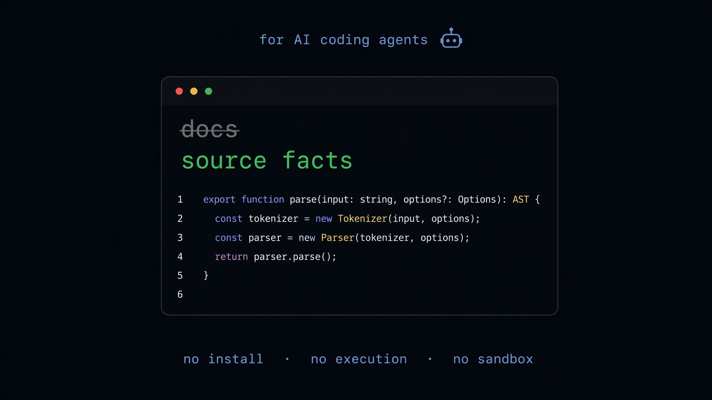

# libpeek

[](https://github.com/WeaveFox/libpeek/actions/workflows/ci.yml)
[](./LICENSE)
[](https://www.skills.sh)

**像检索本地 node_modules 一样浏览任何 npm 包——真实源码，不安装、无沙箱、不执行代码。**



libpeek 从公共 CDN 直读指定版本的 npm 包文件：列文件树、glob 匹配（通配符或模糊文件名）、读任意文件、grep 搜索内容（含 `.d.ts` 类型定义）。

为 vibe-coding 场景而生：在 import 之前验证一个库真实导出的 API，而不是相信模型记忆。[English](./README.md)

## 为什么

- **不需要沙箱** —— 不跑生命周期脚本，被审查的工作区零写入。npm install 钩子是供应链攻击的头号入口，libpeek 不碰它。
- **精确版本** —— 支持 `react@19.1.0`、`latest`、`^19.0.0`；对比任何版本，不限于已安装的那个。
- **真实源码 > 模型记忆** —— 模型会幻觉 API，tarball 不会。
- **与文档工具互补** —— context7 这类工具负责生成式/整理过的文档；libpeek 给出的是源码事实：你所安装的确切版本的真实代码。文档用来建立心智模型；当文档滞后于发布、只覆盖部分 API、或要回答"代码实际上做了什么"时，用 libpeek。

## 安装

### 作为 agent skill（推荐）

```bash
npx skills add WeaveFox/libpeek --skill libpeek
```

通过 [skills.sh](https://skills.sh) 适用于 Claude Code、Cursor、Codex 等 70+ agent。详见 [SKILL.md](./skills/libpeek/SKILL.md)。

### 独立脚本

Node.js >= 18，零依赖：

```bash
node skills/libpeek/scripts/index.mjs list react
```

## 用法

```bash
# 列出包内全部文件
node skills/libpeek/scripts/index.mjs list react@19.1.0

# 按名字找文件：通配符、模糊、或精确文件名
node skills/libpeek/scripts/index.mjs glob zod "dist/**/*.d.ts"
node skills/libpeek/scripts/index.mjs glob lucide-react arrow-left

# 读任意文件的源码
node skills/libpeek/scripts/index.mjs read react package.json

# 正则搜索文件内容（include 限定范围）
node skills/libpeek/scripts/index.mjs grep '{"package":"zod","pattern":"exports","include":"package.json"}'
```

版本：显式 `version` 或内联 `pkg@version` 优先；不传时用 `latest`。完整参数见 [references/usage.md](./skills/libpeek/references/usage.md)。

## 安全性

纯只读 HTTP（unpkg / jsDelivr；`NPM_MIRROR=cn` 优先 npmmirror 国内节点）。零依赖、无 eval、无 shell、不执行包代码。唯一的磁盘写入是 `~/.cache/libpeek` 下的本地缓存（仅缓存的文件内容，从不执行；`LIBPEEK_NO_CACHE=1` 可关闭）——被审查的工作区零写入。威胁模型与审计指引：[references/security.md](./skills/libpeek/references/security.md)。

## 配置

| 环境变量 | 默认值 | 说明 |
| -------- | ------ | ---- |
| `NPM_REGISTRY` | `https://registry.npmjs.org` | packument 源覆盖（私有源可换） |
| `NPM_MIRROR` | `intl` | `cn` 时文件内容优先走 npmmirror |
| `NPM_FILE_MIRRORS` | 内置链 | 逗号分隔的 URL 模板，按序回退 |
| `NPM_TIMEOUT` | `10000` | HTTP 超时（毫秒） |

## Roadmap

- `mdnpeek` —— 同样的只读方式覆盖 MDN Web 文档（搜索 / 文档 / 兼容性）
- PyPI / crates.io 适配器（复用同样的四个命令）
- 免费托管 MCP 端点（`mcp.libpeek.dev`）

## 许可证

[MIT](./LICENSE)
